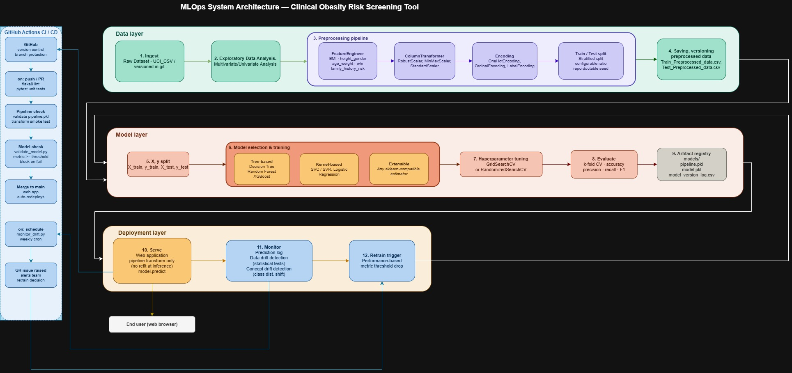
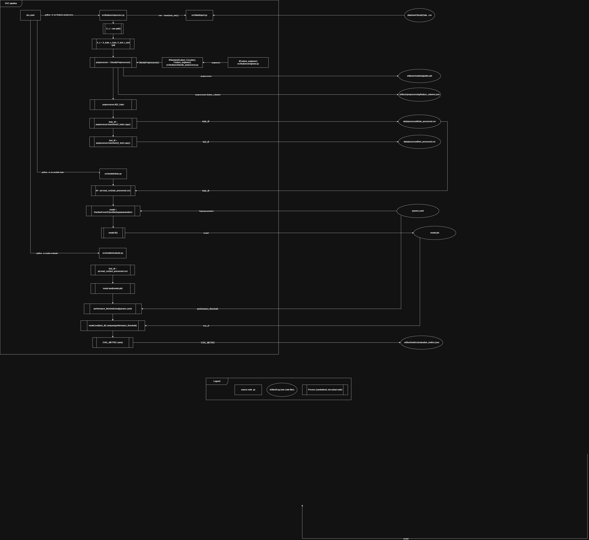
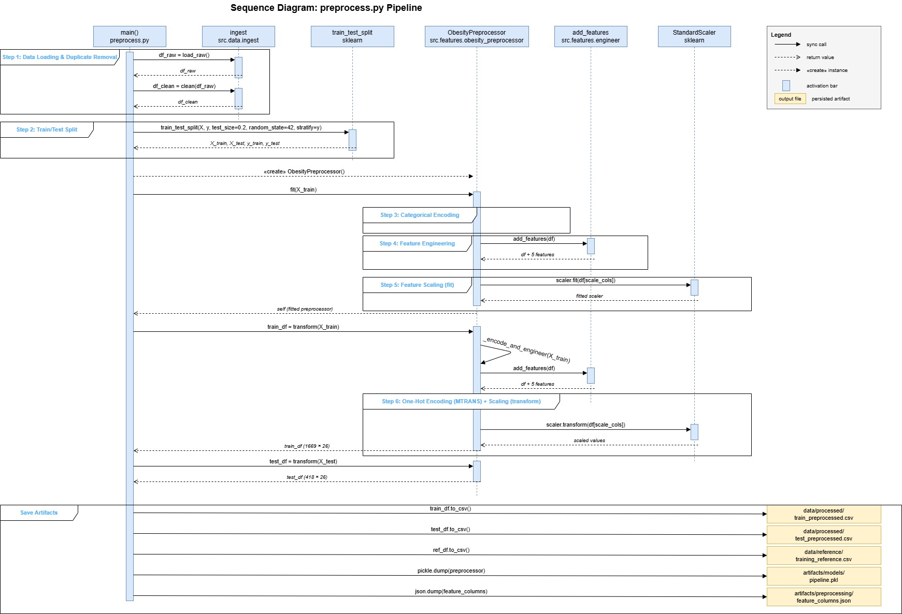

# Obesity Risk Screening Tool

A machine learning pipeline for classifying obesity risk levels from lifestyle and anthropometric features. The project covers the full ML lifecycle — from raw data ingestion through preprocessing, model training, evaluation, monitoring, and a deployed Streamlit web application — with MLOps practices enforced via DVC and GitHub Actions.

---

## Table of Contents

- [Overview](#overview)
- [Architecture Diagrams](#architecture-diagrams)
- [Project Structure](#project-structure)
- [Models](#models)
- [Pipeline Stages](#pipeline-stages)
- [CI/CD Workflows](#cicd-workflows)
- [Getting Started](#getting-started)
- [Running the Pipeline](#running-the-pipeline)
- [Running the Application](#running-the-application)
- [Running Tests](#running-tests)
- [Configuration](#configuration)
- [Monitoring](#monitoring)
- [Key Tooling](#key-tooling)

---

## Overview

The system classifies individuals into one of seven obesity risk categories based on dietary habits, physical activity, family history, and body measurements. The primary model is a Random Forest classifier. A Multi-Layer Perceptron (MLP) is trained and evaluated in parallel as a secondary model for comparison.

The pipeline is fully reproducible via DVC and parameterised through `params.yaml`. All stages are version-controlled and automated through three GitHub Actions workflows covering continuous integration, continuous deployment, and scheduled retraining.

**Dataset:** [UCI Obesity Dataset](https://archive.ics.uci.edu/dataset/544/estimation+of+obesity+levels+based+on+eating+habits+and+physical+condition) — 2,111 records, 16 features, 7 target classes.

---

## Architecture Diagrams

### System Architecture

The diagram below shows the full MLOps system across three layers — data, model, and deployment — and how GitHub Actions CI/CD integrates across all of them.



---

### DVC Pipeline

The DVC pipeline diagram shows how `dvc.yaml` orchestrates execution across the five stages, the data and artifact dependencies between them, and the role of `params.yaml` as the central configuration source.



---

### Preprocessing Sequence

The sequence diagram below shows the internal execution flow of the `preprocess` stage — from raw data ingestion through train/test split, categorical encoding, feature engineering, scaling, and artifact serialisation.



---

## Project Structure

```
.
├── app/                        # Streamlit web application
│   ├── Home.py                 # Landing page
│   ├── components/             # Reusable UI components (confidence display, feature explanation)
│   └── pages/
│       ├── 1_Prediction.py     # Single-record inference page
│       └── 2_Monitoring.py     # Model version log and drift monitoring dashboard
│
├── artifacts/                  # Outputs produced by the DVC pipeline
│   ├── metrics/                # Evaluation metrics JSON files and model version log CSV
│   ├── models/                 # Serialised model and preprocessor pickle files
│   └── preprocessing/          # Feature column definitions
│
├── data/
│   ├── raw/                    # Original UCI dataset (source of truth)
│   ├── processed/              # Train/test splits produced by the preprocess stage
│   ├── reference/              # Training reference distribution for drift detection
│   └── new_data/               # Drop new data here to trigger automated retraining
│
├── src/
│   ├── config.py               # Centralised path and parameter configuration
│   ├── data/ingest.py          # Raw data loading and cleaning
│   ├── features/               # Preprocessing, feature engineering, ObesityPreprocessor
│   ├── models/                 # Train, evaluate, predict, and version logging for RF and MLP
│   └── monitoring/monitor.py   # KS-test based data drift detection
│
├── tests/                      # Pytest test suite (5 test files)
├── monitoring/                 # Runtime drift reports and prediction logs
├── .github/workflows/          # CI, CD, and retrain workflow definitions
├── dvc.yaml                    # DVC pipeline stage definitions
├── params.yaml                 # All hyperparameters and pipeline configuration
└── pyproject.toml              # Ruff and Black configuration
```

---

## Models

| Model | Type | Primary | Performance Threshold |
|---|---|---|---|
| Random Forest | `RandomForestClassifier` | Yes | 0.95 accuracy |
| MLP | `MLPClassifier` | No | 0.90 accuracy |

Both models are trained on the same preprocessed split and evaluated independently. Evaluation results gate the pipeline — a stage fails if the model falls below its configured threshold. Each successful evaluation appends a versioned entry to `artifacts/metrics/model_version_log.csv`.

**Random Forest hyperparameters (defaults in `params.yaml`):**

| Parameter | Value |
|---|---|
| `n_estimators` | 100 |
| `max_depth` | null (unlimited) |
| `min_samples_split` | 2 |
| `min_samples_leaf` | 1 |

**MLP hyperparameters (defaults in `params.yaml`):**

| Parameter | Value |
|---|---|
| `hidden_layer_sizes` | [128, 64] |
| `activation` | relu |
| `max_iter` | 500 |
| `learning_rate_init` | 0.001 |

---

## Pipeline Stages

Managed by DVC. Stages run in dependency order.

```
preprocess → train → evaluate
           ↘ train_mlp → evaluate_mlp
```

| Stage | Command | Output |
|---|---|---|
| `preprocess` | `python -m src.features.preprocess` | Processed CSVs, `pipeline.pkl`, `feature_columns.json` |
| `train` | `python -m src.models.train` | `model.pkl` |
| `evaluate` | `python -m src.models.evaluate` | `evaluation_metrics.json`, version log entry |
| `train_mlp` | `python -m src.models.train_mlp` | `model_mlp.pkl` |
| `evaluate_mlp` | `python -m src.models.evaluate_mlp` | `evaluation_metrics_mlp.json`, version log entry |

---

## CI/CD Workflows

| Workflow | File | Trigger | Actions |
|---|---|---|---|
| CI | `ci.yml` | Push to `main`/`dev`, PR to `main` | Lint (ruff), format check (black), `dvc repro`, pytest |
| CD | `cd.yml` | Push to `main` | Confirms Streamlit Community Cloud deployment |
| Retrain | `retrain.yml` | New data in `data/new_data/`, weekly schedule (Monday 9am UTC), manual dispatch | Full `dvc repro`, pytest, commit updated artifacts |

---

## Getting Started

**Requirements:** Python 3.11+

```bash
# Clone the repository
git clone https://github.com/<your-username>/<your-repo>.git
cd <your-repo>

# Create and activate a virtual environment
python -m venv .venv
source .venv/bin/activate        # Windows: .venv\Scripts\activate

# Install dependencies
pip install -r requirements.txt
```

---

## Running the Pipeline

```bash
# Run all DVC stages (preprocess → train → evaluate → train_mlp → evaluate_mlp)
dvc repro

# Force re-run all stages regardless of cache
dvc repro --no-run-cache

# Run a specific stage only
dvc repro evaluate

# View pipeline status (which stages are cached vs. outdated)
dvc status
```

To change hyperparameters, edit `params.yaml` and re-run `dvc repro`. DVC will detect which stages are affected and only re-run those.

---

## Running the Application

```bash
streamlit run app/Home.py
```

The app runs on `http://localhost:8501` by default. Pages:

- **Home** — project overview
- **Prediction** — enter feature values and receive a predicted obesity risk class with confidence scores
- **Monitoring** — model version history, RF vs MLP metric comparison, and live drift detection

---

## Running Tests

```bash
# Run the full test suite
pytest -v

# Unit tests only — no dvc repro required
pytest tests/test_engineer.py tests/test_preprocess.py tests/test_monitor.py -v

# Integration tests — requires the raw dataset and params.yaml
pytest tests/test_pipeline.py tests/test_model.py -v

# MLP-specific artifact tests — requires dvc repro to have been run
pytest tests/test_mlp.py -v

# With timeout
pytest -v --timeout=60
```

| Test File | Scope | Requires `dvc repro` |
|---|---|---|
| `test_engineer.py` | Feature engineering logic | No |
| `test_preprocess.py` | `ObesityPreprocessor` transform | No |
| `test_monitor.py` | KS-test drift detection | No |
| `test_pipeline.py` | End-to-end data pipeline integrity | No (rebuilds in-process) |
| `test_model.py` | RF and MLP training, accuracy thresholds | No (rebuilds in-process) |
| `test_mlp.py` | MLP artifact loading, metric files, version log | Yes |

---

## Configuration

All pipeline parameters are in `params.yaml`:

```yaml
data:
  test_size: 0.2
  random_state: 42

model:
  n_estimators: 100
  max_depth: null
  min_samples_split: 2
  min_samples_leaf: 1
  performance_threshold: 0.95

mlp:
  hidden_layer_sizes: [128, 64]
  activation: relu
  max_iter: 500
  random_state: 42
  learning_rate_init: 0.001
  performance_threshold: 0.90

monitoring:
  drift_threshold: 0.05
```

---

## Monitoring

Data drift is detected using the Kolmogorov-Smirnov test, comparing the training reference distribution against production prediction logs.

- **Reference data:** `data/reference/training_reference.csv` — written at preprocess time
- **Production log:** `monitoring/logs/production_prediction_log.csv` — updated on every prediction
- **Drift report:** `monitoring/alerts/drift_report.json` — written after each drift check
- **Drift threshold:** `params.yaml > monitoring.drift_threshold` (default: 0.05 p-value)

The Monitoring page in the Streamlit app runs a live drift check and displays the current KS statistic and p-value alongside the model version history.

---

## Key Tooling

| Tool | Purpose |
|---|---|
| scikit-learn | Model training and preprocessing (`RandomForestClassifier`, `MLPClassifier`) |
| DVC | Pipeline reproducibility, stage caching, and data versioning |
| Streamlit | Web application and monitoring dashboard |
| GitHub Actions | CI, CD, and automated retraining workflows |
| pytest | Unit and integration testing |
| ruff | Linting |
| black | Code formatting |
| pandas | Data manipulation |
| scipy | KS-test for drift detection |
